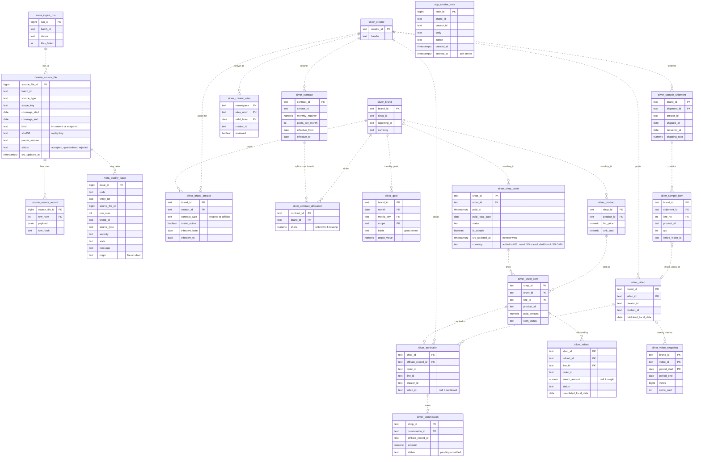

# Schema and diagram

The diagram below is built from the migrations in `backend/db/migrations/` (`001` to `016`: tables are in `001_bronze_meta`, `002_silver`, `007_notes`; `011` adds `silver.shop_order.currency`; the rest are views, indexes and backfills). The SQL is the source of truth. If this page and the SQL ever disagree, the SQL wins.

Mermaid cannot draw a dot inside a table name, so the diagram writes `silver.order_item` as `silver_order_item`, and so on.

## How the layers fit

- **Bronze** keeps every row of every accepted file exactly as it arrived (`bronze.source_file` is the file, `bronze.source_record` is one row of JSON). Nothing is cleaned here, so any number can be traced back to a file and a row.
- **Silver** is the cleaned, typed version: one table per thing in the business (orders, refunds, videos, samples, goals). Rebuilt from accepted Bronze in one transaction, so a replay changes nothing.
- **Gold** is a set of SQL views over Silver. They hold the metric rules (GMV, net sales, projections, freshness). The API reads only Gold.
- **Meta** holds the control tables: source contracts, ingest runs, dataset revisions and quality issues.

Silver tables use natural keys (the ids the source already has), carry `source_file_id`, `row_num` and `row_hash` for lineage, and link to each other by value, not by database foreign keys. An orphan row (for example an attribution whose order is missing) becomes a `meta.quality_issue`; it is never silently dropped. `NULL` always means unknown, never zero.

## Entity diagram

Dotted lines are links by value (no database foreign key). The only real foreign key is the solid line from `bronze.source_record` to `bronze.source_file`.

## Gold views

The Gold views are defined in migrations `003`, `004`, `005`, `006`, `009`, `010`, `011`, `012`, `014`, `015` and `016` (`009` adds the materialized views `gold.mv_sales_line`, `mv_video_activity`, `mv_sample_funnel` and `mv_goal_progress`, which the plain views read; `010` adds the chart views; `011` re-creates several views after the currency and roster rulings; `013` only backfills `brand_id` on quality issues; `007` and `008` add the notes table and indexes). They read Silver (and Meta for freshness). Each one is the single place a metric rule lives:

| View | What it answers |
|---|---|
| `gold.sales_line` | Each order line: is it eligible, its GMV and its refund total. (The API applies the cutoff date when it reads refunds, so a refund only counts once it has completed on or before the date being viewed.) |
| `gold.refund_line`, `gold.commission_line` | Refund and commission rows used as evidence |
| `gold.video_activity` | Each video and whether it qualifies for the month |
| `gold.sample_funnel`, `gold.sample_cost_line` | Each sample item's state, and its cost |
| `gold.creator_performance` | Per creator per month: videos, GMV, refunds, costs |
| `gold.goal_progress` | Per goal: target, actual, projection, required pace and the reasoning text |
| `gold.source_freshness`, `gold.source_coverage` | Current, stale, partial or missing, per brand and source |
| `gold.needs_attention` | Quiet retainer creators, samples with no video, missing sources |
| `gold.unresolved_identity` | Raw creator or product identifiers we could not match |
| `gold.current_as_of` | The simulated "today" |

## App and Meta tables

- `app.creator_note` (migration 007): notes the team saves on a creator (`brand_id`, `creator_id`, `body`, `author`, timestamps, soft delete via `deleted_at`). It lives in its own `app` schema, so a Silver rebuild or `reset` does not erase it (`reset --purge-notes` does).
- `meta.source_contract`: per source type, `kind`, `cadence` and `lag_days`, used for freshness.
- `meta.ingest_run`: one row per ingest (`status`, `files_failed`). `meta.dataset_revision`: a new row only when data changed. `meta.quality_issue`: one row per problem (`code`, `severity`, `state`, `origin` is `file` or `silver`, `brand_id`).

## Keys and replay

- A file is identified by `(source_type, scope_key, coverage_start, coverage_end, sha256, parser_version)`. The same file sent twice is a no-op.
- When two versions of the same order or refund exist, the one with the newest `src_updated_at` wins, whatever order they arrived in.
- Snapshot sources (roster, samples, products, plans) replace the previous snapshot; incremental sources (orders, affiliate orders, returns, weekly videos) only add or update.
